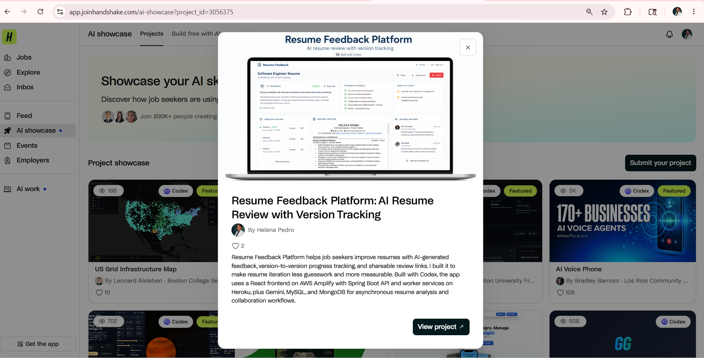

# AI-powered Resume Feedback Platform

Frontend application for a version-aware resume review workflow.

**Featured in the [Handshake AI Showcase](https://app.joinhandshake.com/ai-showcase?project_id=3056375) as part of the OpenAI Developers x Handshake Codex Creator Challenge.**



## Why this project exists

Resume Feedback Platform came from conversations with talented, qualified people who asked for help planning their careers. Their experience, technical ability, and potential were real, but their resume often did not convey that value clearly enough.

Writing a strong resume is its own skill. The product helps candidates make their professional value more visible through a structured improvement loop:

- upload a resume in Portuguese or English
- receive structured AI feedback tied to that exact version
- capture target opportunities such as jobs, public exams, scholarships, promotions, or career-change targets
- run targeted resume-vs-opportunity reviews without replacing the original resume
- upload revised versions and compare progress over time
- keep feedback, comments, and shared review links attached to the resume workflow

The central product question is:

**Did this new version actually get better?**

## The problem I solve

This project turns resume review into a **_version-aware product workflow_** instead of a one-off file upload.

It solves three practical problems:

- `Review context loss`: feedback, comments, and file versions often drift apart
- `Weak iteration visibility`: most tools can review a file, but cannot explain progress between versions
- `Low-quality collaboration`: external reviewers need a simpler, controlled way to preview and comment without joining the full account workflow
- `Weak opportunity targeting`: candidates often need to adapt a resume to a specific vacancy or exam without inventing unsupported experience

## User Workflow

The frontend supports a versioned resume review workflow.

Implemented behavior:

- Users can see the current AI review and the comparison with the previous version.
- Progress output separates improvements, unchanged issues, and new issues.
- Target opportunity reviews separate matched, weak, and missing requirements before a candidate creates a targeted version.
- Reviewers can comment on the version under discussion.
- Version history keeps uploads, AI outputs, comments, targets, and share links in one workflow.

The UI distinguishes current-version feedback, version-to-version progress, and target-specific alignment instead of showing all AI output as one generic review.

## Featured

This project was also shared in a LinkedIn post about the Handshake feature.

- [Open the embedded feature page](./docs/featured.html)
- [Open the LinkedIn post directly](https://www.linkedin.com/embed/feed/update/urn:li:ugcPost:7462595076766982145)
- [Open the Handshake showcase entry](https://app.joinhandshake.com/ai-showcase?project_id=3056375)

## What the product does

The current app supports:

- email/password sign up and sign in
- Google sign in via Google Identity Services
- resume creation and version uploads
- version-aware preview and download
- AI feedback generation with async job polling
- language-aware AI feedback for Portuguese and English resume workflows
- AI progress comparison between resume versions
- target opportunity capture and targeted resume-vs-opportunity reviews
- recruiter-style feedback display with summary, strengths, and improvements
- share link creation, revocation, expiration, and usage limits
- version-specific comments
- pinned resumes and dashboard search
- basic profile management

## Product model

The UI presents three AI artifact types separately:

1. `AI Feedback for the current version`
   Reviews one resume version.

2. `Progress since the previous version`
   Compares one resume version with the previous version.

3. `Targeted review for a specific opportunity`
   Compares a source resume version with a stored target opportunity.

These are separate backend contracts and separate UI states.

## Frontend Scope

This repository contains the React frontend for the resume feedback platform. It communicates with the separate `resume-api` service for authentication, resume data, AI review jobs, comments, and share links; it does not run the API or AI processing itself.

## Tech Stack

- React 18 and TypeScript
- Vite 5
- React Router 6
- TanStack Query for API-backed data, caching, mutations, and polling
- Tailwind CSS, shadcn/ui, and Radix UI
- React Hook Form and Zod
- `react-pdf` for resume previews

## UI Architecture

The app separates route composition, feature orchestration, presentation, and backend communication:

- `src/pages` contains route-level screens.
- `src/features` contains feature hooks and query orchestration.
- `src/components` contains reusable and feature-specific UI.
- `src/services` contains the API client and REST service modules.
- `src/contexts` contains app-wide authentication and language providers.
- `src/types` contains shared API and UI contracts.

Typical data flow:

`page → feature hook/query → service → resume-api`

Feature hooks pass the resulting data and actions to presentation components. For example, `useResumeDetailsPage` coordinates resume, comment, and share-link data for `ResumeDetails`; AI and target-opportunity query hooks poll their respective jobs while they are pending or processing.

## Application Structure

The codebase is organized by responsibility:

- `src/pages` route-level screens
- `src/components` reusable UI and feature components
- `src/components/ai-feedback` modularized AI feedback presentation components
- `src/components/resume-details` modularized resume details page components
- `src/features` feature hooks and orchestration logic
- `src/features/target-opportunities` target opportunity query hooks and mutation orchestration
- `src/services` API client and service layer
- `src/contexts` app-wide providers and compatibility wrappers
- `src/lib` small shared utilities
- `src/types` shared TypeScript contracts

## UI Architecture Notes

The UI layer is intentionally split across route screens, feature orchestration, and reusable presentation components.

- `src/pages` owns route composition, page shells, and page-level layout
- `src/features` owns stateful hooks and feature orchestration
- `src/components` owns reusable presentational building blocks and feature UI
- `src/components/ui` owns low-level design-system primitives
- feature folders like `src/components/ai-feedback` and `src/components/resume-details` keep larger areas maintainable

Typical flow:

1. a route component in `src/pages` renders the screen shell
2. the page or feature component calls a hook from `src/features`
3. that hook coordinates queries and service calls
4. resulting data is passed into focused presentational components in `src/components`

For deeper UI conventions, see [docs/ui-architecture.md](docs/ui-architecture.md).

## Main Routes

Public routes:

- `/`
- `/about`
- `/auth`
- `/share/:token`

Protected routes:

- `/my-resumes`
- `/upload`
- `/resume/:id`
- `/profile`

## AI data model

The backend returns version feedback in this shape:

```ts
{
  summary: string;
  strengths: string[];
  improvements: string[];
}
```

For version-to-version comparison, the backend also returns progress data:

```ts
{
  summary: string;
  progressStatus: string;
  progressScore: number;
  improvedAreas: string[];
  unchangedIssues: string[];
  newIssues: string[];
}
```

For targeted resume-vs-opportunity review, the backend returns:

```ts
{
  summary: string;
  fitScore: number | null;
  matchedRequirements: Array<{ requirement: string; evidence: string[]; confidence: string }>;
  weakRequirements: Array<{ requirement: string; currentEvidence: string; recommendedFix: string }>;
  missingRequirements: Array<{ requirement: string; candidateAction: string }>;
  recommendedChanges: Array<{ section: string; change: string; rationale: string }>;
  positioningAdvice: string[];
  integrityWarnings: string[];
}
```

The frontend uses these responses differently:

- feedback explains the quality of the current version
- progress explains what changed between the current version and the previous one
- targeted review explains fit against a concrete opportunity and protects evidence integrity

## State and Data Flow

TanStack Query manages API-backed data, including resume lists and details, comments, share links, AI feedback, and target-opportunity reviews. React context provides app-wide authentication and language state; local component state handles transient UI interactions such as selected previews and open dialogs.

The frontend requests AI feedback and comparisons through the `resume-api` REST contract. AI providers, job processing, storage, and persistence are backend responsibilities.

## API Configuration

Create a `.env` file in the project root:

```bash
VITE_API_URL=https://your-api-host.com
VITE_GOOGLE_CLIENT_ID=your_google_client_id
VITE_EMBED_ALLOWED_PARENT_ORIGINS=https://your-personal-site.com
```

- `VITE_API_URL` is optional; when omitted, the app uses `https://resumefeedback-api.hmpedro.com`.
- `VITE_GOOGLE_CLIENT_ID` is needed for Google sign-in.
- `VITE_EMBED_ALLOWED_PARENT_ORIGINS` is optional and is used to configure Google sign-in when the app is embedded.

The API client adds the stored bearer token to authenticated requests and sends JSON for non-file requests. Resume upload and version upload use `FormData`. See [Embedding](docs/embedding.md) for iframe hosting requirements.

## Authentication

The frontend supports email/password registration and sign-in, plus Google sign-in. It persists the auth token in `localStorage`, reconstructs user state from the token, and uses `ProtectedRoute` to guard account pages. Authentication and authorization are ultimately enforced by the backend API.

## Local Development

Prerequisites:

- Node.js 18+
- npm 9+ or Bun

Install dependencies:

```bash
npm install
```

Start the dev server:

```bash
npm run dev
```

Build for production:

```bash
npm run build
```

Preview the production build:

```bash
npm run preview
```

Run lint:

```bash
npm run lint
```

## Available Scripts

```json
{
  "dev": "vite",
  "build": "vite build",
  "build:dev": "vite build --mode development",
  "lint": "eslint .",
  "preview": "vite preview"
}
```

## Current UX Areas

- landing and about pages explain the problem and the workflow
- dashboard shows searchable and pinnable resume workflows
- upload page supports new resumes and additional versions
- resume details page combines AI review, progress comparison, target opportunities, preview, version history, comments, and share links
- shared resume page supports external review through tokenized access

## Project Notes

- local storage is currently used for auth token persistence and pinned resume preferences
- this is a frontend-only repository; the backend API and AI jobs are expected to exist elsewhere

## Related Docs

- `docs/featured.html` for the LinkedIn embed page
- `docs/ui-architecture.md` for UI-layer structure, boundaries, and conventions
- `docs/embedding.md` for iframe hosting and Google sign-in embed configuration
